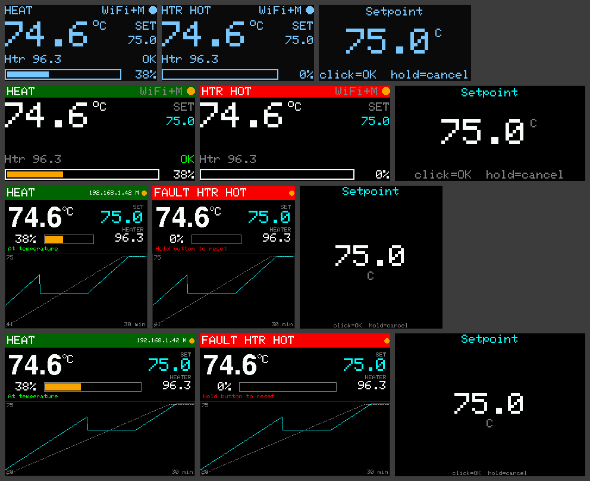

# Paraffin PID — регулятор нагревателя для плавки парафина

[](https://github.com/vicgor/paraffin-pid/actions/workflows/ci.yml)

Прошивка ПИД-регулятора температуры для ванны плавки парафина/воска.
Один исходный код собирается под **RP2350 (Pico 2 / Pico 2 W)**, **ESP32-S3**, **ESP32-C6**
и разные дисплеи: **OLED 0.96"/1.3"**, **TFT 0.96" 80×160**, **TFT 1.14"–2.8"** (ST7735/ST7789/ILI9341).

## Возможности

- ПИД с анти-windup, D по измерению с фильтром, зоной интегрирования и ограничением мощности.
- Мягкий разогрев: рампа уставки (°C/мин) с удержанием близко к реальной температуре —
  на плато плавления интеграл не «набегает», после плато нет перерегулирования.
- Релейный автотюнинг (Острём–Хэгглунд), правила Ziegler–Nichols / Tyreus–Luyben / без перерегулирования.
- Медленный ШИМ твердотельного реле (окно 2 с, разрешение 1 % при 50 Гц).
- Два DS18B20 на одной шине: в парафине (регулирование) и на ТЭНе (защита, необязательный).
- Защиты: перегрев парафина и ТЭНа, обрыв/сбой датчика, «нагрев есть — роста нет»,
  «нагрев выключен — температура растёт» (пробитое SSR), сторожевой таймер, авария с фиксацией
  и сбросом только после устранения причины. После перезагрузки нагрев **не** включается сам.
- Энкодер с кнопкой (или 3 кнопки), меню, график 30 мин на больших TFT, зуммер.
- Wi-Fi: веб-интерфейс с графиком и настройками, JSON API, MQTT + автообнаружение Home Assistant
  (climate-сущность), резервная точка доступа, mDNS (`http://paraffin.local`).
- Консоль USB-Serial 115200 (`help`).
- Логика регулятора платформонезависима и покрыта тестами на модели «ТЭН + ёмкость с плавлением».



## ⚠️ Безопасность — прочтите до сборки

Парафин горюч (температура вспышки ≈ 200 °C), пары при перегреве легко воспламеняются, а горящий
парафин **нельзя тушить водой**. Программные защиты не заменяют аппаратные:

1. **Обязательно** последовательно с ТЭНом — нормально-замкнутый биметаллический термовыключатель
   (KSD301/KSD9700 на 100–120 °C, с ручным возвратом — лучше) и/или термопредохранитель на корпусе ванны.
   Он сработает, даже если SSR пробьёт накоротко (типичный отказ SSR — именно «залип включённым»).
2. Предохранитель/автомат по фазе, заземление корпуса, SSR на радиаторе (для 1 кВт SSR-25DA греется).
3. По возможности — водяная баня («двойной котёл»): физически ограничивает 100 °C.
4. DS18B20 работает только до **125 °C**. Если поверхность ТЭНа горячее — датчик ТЭНа ставьте
   на корпус/рубашку, а для самого ТЭНа используйте термовыключатель.
5. Не оставляйте плавку без присмотра. Держите рядом крышку и порошковый/углекислотный огнетушитель.

## Сборка и прошивка

Нужен [PlatformIO](https://platformio.org/) (VS Code + расширение или `pip install platformio`).

```bash
pio run -e esp32s3-oled -t upload      # собрать и прошить
pio device monitor                      # консоль 115200
pio test -e native                      # тесты логики на ПК
```

| Окружение | Плата | Дисплей |
|---|---|---|
| `esp32s3-oled` / `-sh1106` / `-tft096` / `-tft` / `-ili9341` | ESP32-S3-DevKitC-1 | SSD1306 / SH1106 / ST7735 80×160 / ST7789 240×320 / ILI9341 |
| `esp32c6-oled` / `-tft096` / `-tft` | ESP32-C6-DevKitC-1 | |
| `pico2-oled` / `-tft096` / `-tft` | Raspberry Pi Pico 2 (без Wi-Fi) | |
| `pico2w-oled` / `-tft096` / `-tft` | Raspberry Pi Pico 2 W | |

Другие размеры экрана задаются флагами (см. `include/display_config.h`), например TFT 1.3" 240×240:

```ini
[env:esp32s3-st7789-240]
extends = mcu_esp32s3
build_flags = ${mcu_esp32s3.build_flags} -DDISPLAY_ST7789 -DDISP_W=240 -DDISP_H=240
```

Пины переопределяются так же: `-DPIN_SSR=38`. Энкодер крутится «не туда» — `-DENC_REVERSE`.
Вместо энкодера — три кнопки: `-DPIN_BTN_UP=.. -DPIN_BTN_DOWN=..` (OK — `PIN_ENC_BTN`).
На 0.96" IPS цвета негативные — `-DST7735_TAB=INITR_MINI160x80`.

Платформы:
- ESP32-S3 — официальная [platformio/espressif32](https://github.com/platformio/platform-espressif32)
  7.1.3 (Arduino core 2.0.17).
- ESP32-C6 — [pioarduino](https://github.com/pioarduino/platform-espressif32) (Arduino core 3.x,
  единственный вариант с поддержкой C6).
- RP2350 — ядро [arduino-pico](https://github.com/earlephilhower/arduino-pico).

PlatformIO нужно запускать на **Python 3.10–3.14**: pioarduino проверяет версию при загрузке,
и если она установлена в `~/.platformio`, на Python 3.15 падает даже сборка S3. На macOS с
Homebrew-Python 3.15: `brew uninstall platformio && uv tool install --python 3.13 platformio`.

### CI

GitHub Actions (`.github/workflows/ci.yml`) на каждый push и pull request прогоняет
`pio test -e native`, затем параллельно собирает все 14 окружений. Готовые прошивки
(`firmware.bin` / `firmware.uf2`) лежат в артефактах запуска 30 дней.

## Подключение

```
             3.3V ──┬──────────────┐
                   4k7             │
 DS18B20 ×2  DQ ───┴──── PIN_ONEWIRE
 (VDD 3.3V, GND)

 PIN_SSR ─────────── SSR (+)  «3–32 V DC»      ~220 В L ── автомат ── SSR ── KSD301 ── ТЭН ── N
 GND     ─────────── SSR (−)                   (термовыключатель — ОБЯЗАТЕЛЬНО)

 Энкодер EC11:  A → PIN_ENC_A, B → PIN_ENC_B, C → GND, кнопка → PIN_ENC_BTN / GND
 Зуммер (активный, через NPN/MOSFET) → PIN_BUZZER
 OLED I2C:  SDA, SCL, 3.3V, GND
 TFT SPI:   SCK, MOSI(SDA), CS, DC, RST, BL(подсветка), 3.3V, GND
```

| Сигнал | ESP32-S3 | ESP32-C6 | Pico 2 / 2 W |
|---|---|---|---|
| DS18B20 (1-Wire) | 4 | 3 | GP2 |
| SSR | 5 | 2 | GP3 |
| Зуммер | 16 | 11 | GP9 |
| Энкодер A / B / кнопка | 6 / 7 / 15 | 18 / 19 / 20 | GP6 / GP7 / GP8 |
| I2C SDA / SCL | 8 / 9 | 6 / 7 | GP4 / GP5 |
| TFT SCK / MOSI / CS | 12 / 11 / 10 | 21 / 22 / 23 | GP18 / GP19 / GP17 |
| TFT DC / RST / BL | 13 / 14 / 21 | 0 / 1 / 10 | GP20 / GP21 / GP22 |

Советы: подтяните вывод SSR к GND резистором 10 кОм — при сбросе МК реле гарантированно
выключено. Длинный кабель DS18B20 — витая пара, подтяжка 2.2–4.7 кОм у МК.
Датчик в парафине — в гильзе из нержавейки, на середине глубины и не вплотную к ТЭНу.

## Управление

| Где | Вращение | Клик | Удержание 1.2 с |
|---|---|---|---|
| Главный экран | уставка ±0.5 °C | меню | Пуск / Стоп; в аварии — сброс |
| Меню | выбор пункта | изменить / выполнить | назад |
| Редактирование | значение | сохранить | отмена |

Надписи на дисплее — латиницей (встроенный шрифт Adafruit GFX не содержит кириллицы);
веб-интерфейс — на русском.

## Первый запуск и настройка ПИД

1. Включите без нагрузки: в консоли `sensors` — должны найтись датчики. Первый найденный
   назначается «парафином», второй — «ТЭНом»; поменять местами — меню *Sensors* → клик или `swap`.
2. Wi-Fi: `wifi МояСеть пароль`, затем `reboot` (или подключитесь к точке `Paraffin-xxxx`,
   пароль `paraffin123`, откройте `192.168.4.1` на ESP32 / адрес с экрана на Pico 2 W).
3. Расплавьте парафин полностью при умеренной уставке (коэффициенты по умолчанию консервативные).
4. Поставьте рабочую уставку и запустите **Autotune** (меню или веб). Регулятор будет включать
   и выключать нагрев вокруг уставки (±0.5 °C), измерит 3–4 цикла и сам применит коэффициенты.
   Ограничьте мощность тюнинга (*Tune power*), если ТЭН сильно мощнее нужного — меньше перелёт.
5. Если перерегулирование велико — выберите правило *NoOS* и повторите тюнинг или уменьшите Kp.

Ключевые параметры (полный список — `show` в консоли или веб-страница):

| Параметр | По умолч. | Смысл |
|---|---|---|
| `targetC` | 70 | уставка, °C |
| `rampCpm` / `rampHoldC` | 2 / 4 | рост уставки °C/мин; уставка не выше T+4 °C |
| `kp` / `ki` / `kd` | 10 / 0.02 / 100 | %/°C, %/(°C·с), %·с/°C |
| `iZoneC` | 5 | интеграл копится только в ±5 °C от цели |
| `outMaxPct` | 100 | ограничение мощности |
| `maxProcessC` / `maxHeaterC` | 105 / 120 | аварийные температуры |
| `runawayWindowMin` | 30 | окно «нагрев есть — роста нет»; должно быть больше плато плавления |
| `idleRiseC` | 8 | рост T при выключенном нагреве → «SSR STUCK» |

> Плато плавления: пока парафин плавится, температура стоит на месте (скрытая теплота
> ≈ 200 кДж/кг). Для больших объёмов увеличьте `runawayWindowMin` или поставьте датчик на ТЭН —
> тогда рост проверяется и по нему, и ложных срабатываний не будет.

## Аварии

| Код (дисплей) | Причина | Что делать |
|---|---|---|
| `SENSOR` | датчик парафина не отвечает | проверить провод/подтяжку, `rescan` |
| `HTR SENS` | пропал датчик ТЭНа | проверить; если не нужен — `set heaterSensorRequired 0` |
| `OVERTEMP` / `HTR HOT` | перегрев | дождаться остывания, найти причину |
| `NO RISE` | греем, а температура не растёт | датчик выпал из ванны? ТЭН/SSR оборван? |
| `SSR STUCK` | нагрев выключен, а температура растёт | **обесточить**, заменить SSR |
| `TUNE ERR` | автотюнинг не дал колебаний за 4 ч | уменьшить гистерезис/мощность |
| `WDT RST` | перезагрузка по сторожевому таймеру | проверить питание, помехи от нагрузки |

Сброс — удержание кнопки, «Reset fault», `ack` или кнопка в вебе. Пока причина есть, сброс не пройдёт.

## Сеть

Веб: `http://<ip>/` (или `http://paraffin.local/`). Пароль: `webpass <пароль>` (логин `admin`).

JSON API:

```
GET  /api/status                 состояние
GET  /api/history                история за 30 мин (шаг 5 с)
POST /api/cmd       {"cmd":"start|stop|tune|ack"} | {"cmd":"target","value":75}
GET  /api/settings               все параметры
POST /api/settings  {"ctl":{"kp":12}} | {"net":{"ssid":"…"}}
POST /api/reboot
```

MQTT (`mqtt 192.168.1.10 1883 user pass`, затем `reboot`), базовый топик `paraffin/<id>`:

```
paraffin/<id>/state        JSON состояния (retained, раз в 5 с)
paraffin/<id>/status       online / offline (LWT)
paraffin/<id>/cmd          start | stop | tune | ack
paraffin/<id>/target/set   75.5
paraffin/<id>/mode/set     heat | off
```

С включённым discovery Home Assistant сам создаст термостат и датчики мощности/ТЭНа/аварии.

## Устройство кода

```
lib/control/        платформонезависимая логика (тестируется на ПК)
  Pid.h               ПИД
  SetpointRamp.h      рампа уставки
  Autotune.*          релейный автотюнинг
  Safety.*            защиты
  Controller.*        конечный автомат STOP/HEAT/TUNE/FAULT
src/
  hal.*               мьютекс, watchdog, цикл управления (FreeRTOS-задача / ядро 1 RP2350)
  app.*               связка датчики → регулятор → SSR, потокобезопасный API
  sensors.*  ssr.h  input.*  buzzer.h  settings_store.*  settings_fields.h
  display/            OLED / TFT (отрисовка полосами без мерцания)
  ui.*                экраны и меню
  net/                Wi-Fi, веб, API, MQTT
  cli.*               консоль
test/test_control/    тесты на модели объекта с плавлением
```

Регулятор работает в отдельном контексте (на ESP32 — задача FreeRTOS с приоритетом выше
`loop()`, на RP2350 — второе ядро), поэтому зависание веба или переподключение MQTT не
влияют на управление нагревом. Этот же контекст кормит сторожевой таймер (5 с).

## Лицензия

[MIT](LICENSE). Прошивка управляет нагревателем и поставляется «как есть», без гарантий:
ответственность за аппаратные защиты и безопасную эксплуатацию (см. раздел «Безопасность»)
лежит на том, кто собирает и использует устройство.
