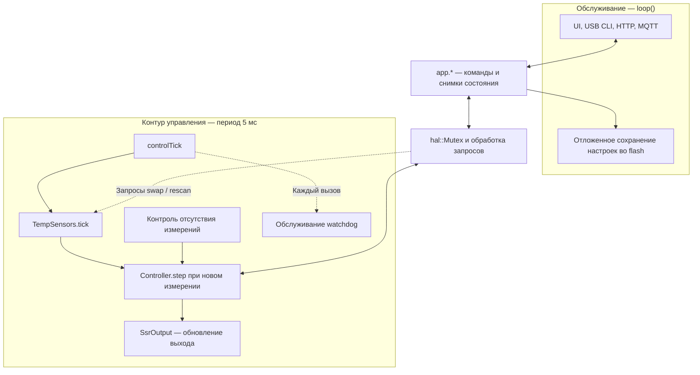
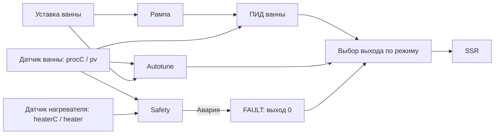

# Архитектура и роли датчиков

[Вернуться к README](../README.md)

## Контексты выполнения

Схема показывает границы выполнения и обмен данными, а не точный порядок вызовов функций.

- ESP32: отдельная задача FreeRTOS; RP2350: отдельное ядро.
- Период контекста управления 5 мс не равен периоду измерений. В текущем драйвере DS18B20 преобразования запускаются раз в 1000 мс, чтение выполняется после 760 мс без блокирующего ожидания преобразования.
- Веб, MQTT, отрисовка и сохранение настроек выполняются вне контура управления.
- Схема не описывает запуск после перезагрузки и не является доказательством отсутствия гонок или блокировок.

Источники: [main.cpp](../src/main.cpp), [app.cpp](../src/app.cpp), [hal.cpp](../src/hal.cpp), [sensors.cpp](../src/sensors.cpp).

## Роли датчиков

Датчик ванны — обратная связь ПИД и Autotune. Датчик нагревателя не входит непосредственно в расчёт ПИД: каскадное регулирование и плавный ограничитель мощности по его температуре пока не реализованы. Показания двух датчиков не усредняются.

| Проверка | Использование измерений |
|---|---|
| OVERTEMP | Достоверная температура ванны не ниже maxProcessC |
| HTR HOT | Достоверная температура обнаруженного датчика нагревателя не ниже maxHeaterC |
| SENSOR / HTR SENS | Ошибки чтения; отсутствие обязательного датчика нагревателя |
| NO RISE | Больший из приростов температуры ванны и достоверного датчика нагревателя за контрольное окно |
| SSR STUCK | Рост большей из доступных достоверных температур при выключенном режиме нагрева; проверка требует достоверной температуры ванны |

heaterSensorRequired=0 разрешает отсутствие второго датчика, но не отключает проверки уже обнаруженного датчика. Команда swap меняет роли щупов; после неё необходимо проверить соответствие pv физическому датчику ванны.

Оба DS18B20 используют общую шину 1-Wire и разные ROM-адреса. Команда преобразования отправляется всем датчикам одновременно. Второй датчик не заменяет первый при его отказе.

Источники: [Controller.cpp](../lib/control/src/Controller.cpp), [Safety.cpp](../lib/control/src/Safety.cpp), [sensors.cpp](../src/sensors.cpp).

## Границы изменения

Это документация текущего алгоритма, а не схема электрического подключения и не изменение защит. Все окружения остаются без изменений; новые unit-тесты не требуются. Перед слиянием следует проверить отображение Mermaid и соответствие подписей исходному коду.
