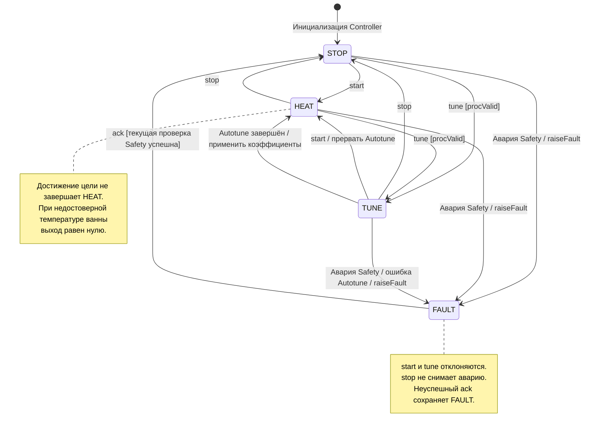

# Состояния регулятора

[Вернуться к README](../README.md)

Документ описывает текущую реализацию автомата состояний.
Это описание поведения кода, а не подтверждение выполнения всех
требований безопасности. Известные ограничения перечислены ниже.

## Состояния и переходы

| Состояние | Значение в коде | Назначение |
|---|---|---|
| STOP | Mode::Idle | Регулирование остановлено, выход равен нулю |
| HEAT | Mode::Run | Регулирование температуры ванны по ПИД |
| TUNE | Mode::Tune | Релейный Autotune по температуре ванны |
| FAULT | Mode::Fault | Зафиксирована авария, выход равен нулю |

Диаграмма показывает автомат Controller. Поведение приложения при
перезагрузке, включая watchdog и autoResume, описано отдельно ниже.

Источники:
[Controller.h](../lib/control/src/Controller.h),
[Controller.cpp](../lib/control/src/Controller.cpp).

## Команды и условия

| Событие | Условие в текущем коде | Результат |
|---|---|---|
| start из STOP | Состояние не FAULT | Сброс ПИД и рампы, переход в HEAT |
| start из HEAT | Уже выполняется регулирование | Успех без повторной инициализации |
| start из TUNE | Состояние не FAULT | Прерывание Autotune, переход в HEAT |
| tune из STOP или HEAT | procValid и состояние не FAULT | Запуск Autotune, переход в TUNE |
| tune из TUNE | procValid | Повторный запуск Autotune |
| stop из HEAT или TUNE | Состояние не FAULT | Прерывание Autotune, выход 0, переход в STOP |
| stop из STOP | Состояние не FAULT | Выход 0, сброс истории Safety |
| stop из FAULT | Авария зафиксирована | Состояние не меняется |
| start или tune из FAULT | Авария зафиксирована | Отказ |
| ack из FAULT | Новый SafetyMonitor не обнаружил ошибку | Очистка аварии, переход в STOP |
| ack из FAULT | Новый SafetyMonitor обнаружил ошибку | Отказ, состояние остаётся FAULT |
| ack вне FAULT | Нет зафиксированной аварии | Успех без изменения состояния |
| Изменение уставки или настроек | Применение через API контроллера | Само по себе не меняет режим |

В текущем коде start() не проверяет достоверность измерения перед
переходом в HEAT. Это не означает разрешение греть без датчика:
при обработке недостоверного измерения ванны step() выдаёт нулевую
мощность. Фиксация SENSOR зависит от счётчика ошибок.

У startTune() есть дополнительная проверка procValid, но нет отдельной
полной проверки Safety внутри самой команды. Проверки Safety выполняются
при последующих вызовах step().

## Расчёт выхода и аварии

На каждом вызове step():

1. Сохраняется полученное измерение.
2. Если режим не FAULT, выполняется SafetyMonitor::check().
3. При обнаружении аварии выполняется enterFault().
4. Рассчитывается выход в соответствии с текущим режимом.
5. Выход ограничивается диапазоном 0…outMaxPct.

| Режим | Источник мощности |
|---|---|
| STOP | 0 |
| HEAT | ПИД по температуре ванны; при procValid=false — 0 |
| TUNE | Autotune по температуре ванны; при procValid=false — 0 |
| FAULT | 0 |

Достижение целевой температуры формирует EV_AT_TEMP, но не переводит
регулятор в STOP: он продолжает поддерживать температуру.

При успешном Autotune контроллер применяет новые коэффициенты,
формирует EV_TUNE_DONE и автоматически переходит в HEAT.
На шаге завершения Autotune выход равен нулю.
Это продолжение явно запущенного тюнинга, а не автозапуск после перезагрузки.

enterFault():

- Прерывает Autotune.
- Записывает код аварии.
- Обнуляет выход.
- Формирует EV_FAULT.
- Переводит контроллер в FAULT.

Проверки датчиков и перегрева действуют также в STOP.
NO RISE относится к включённому режиму нагрева.
SSR STUCK отслеживает рост температуры при выключенном режиме нагрева,
а не при каждом выключенном импульсе SSR внутри рабочего окна.

После фиксации FAULT новые измерения продолжают сохраняться, но обычная
проверка Safety в step() не выполняется. Повторная проверка запускается
командой ack.

Источники:
[Controller.cpp](../lib/control/src/Controller.cpp),
[Safety.cpp](../lib/control/src/Safety.cpp),
[app.cpp](../src/app.cpp),
[ssr.h](../src/ssr.h).

## Перезагрузка и сброс аварии

### Поведение при перезагрузке

Приложение сначала инициализирует SSR в выключенном состоянии,
затем запускает контроллер и контур управления.

В проверенной реализации app.cpp присутствуют следующие ветви:

- После сброса по watchdog фиксируется WDT RST.
- Иначе при autoResume && wasRunning устанавливается отложенный запуск.
- При поступлении достоверного измерения ванны отложенный запуск
  вызывает Controller::start().

Последняя ветвь противоречит требованию проекта:
после перезагрузки нагрев должен запускаться только явной командой.

До устранения этого расхождения autoResume должен оставаться равным 0.
Диаграмма не должна трактоваться как гарантия отсутствия автозапуска
при любых сохранённых настройках.

### Что проверяет ack

ack() создаёт новый SafetyMonitor, сбрасывает его историю и проверяет
последнее измерение с heatingEnabled=false.

Это позволяет проверить текущие признаки ошибок датчиков и перегрева,
но не доказывает устранение всех возможных причин:

- NO RISE не проверяется как активный нагрев: heatingEnabled=false.
- SSR STUCK нельзя повторно подтвердить одним вызовом без временной истории.
- Причины TUNE ERR и WDT RST не диагностируются этой проверкой.
- Проверка ошибок датчиков использует счётчики и наличие датчиков;
  она не эквивалентна требованию достоверности обоих измерений.

Поэтому подпись перехода FAULT → STOP означает
«текущая проверка Safety успешна», а не
«физическая причина аварии гарантированно устранена».

Успешный ack возвращает STOP и сам не запускает нагрев.
Устранение причины аварии остаётся обязательным условием эксплуатации.
После SSR STUCK необходимо обесточить силовую часть и проверить её;
сброс сообщения не является ремонтом SSR.

Источники:
[app.cpp](../src/app.cpp),
[Controller.cpp](../lib/control/src/Controller.cpp),
[Safety.cpp](../lib/control/src/Safety.cpp).

## Проверка документации

Этот документ не меняет исполняемый код, настройки или защиты.
Все аппаратные окружения и native-тесты остаются без изменений.
Новые unit-тесты для документального изменения не добавляются.

Перед слиянием:

- Проверить рендер stateDiagram-v2 на GitHub.
- Сверить переходы с актуальными start(), stop(), startTune(), ack() и step().
- Сверить запуск приложения с app::begin() и controlTick().
- Не отмечать выявленные расхождения безопасности как исправленные
  только на основании изменения документации.

Если поведение регулятора будет изменяться, потребуются отдельные
тесты в test/test_control и стендовая проверка без парафина.
